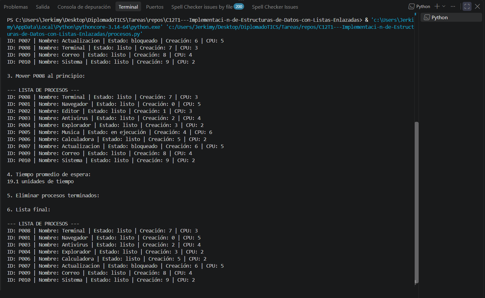
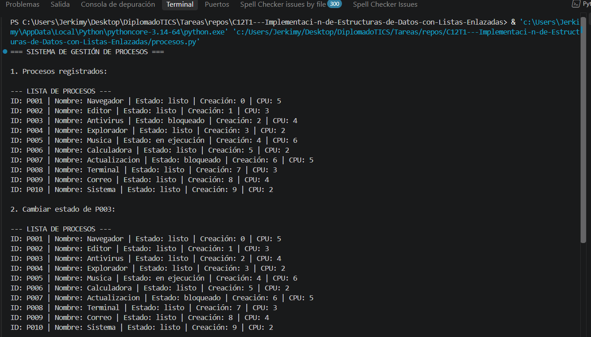
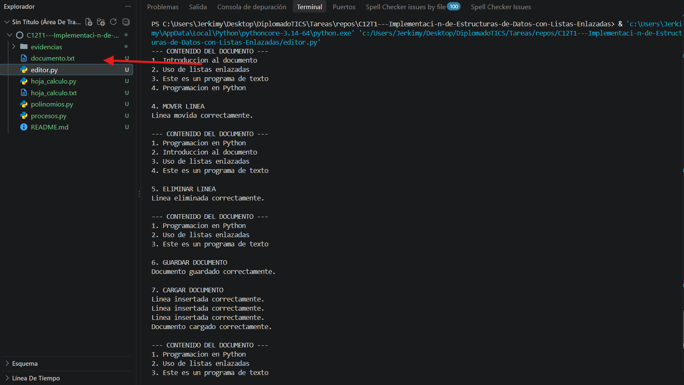
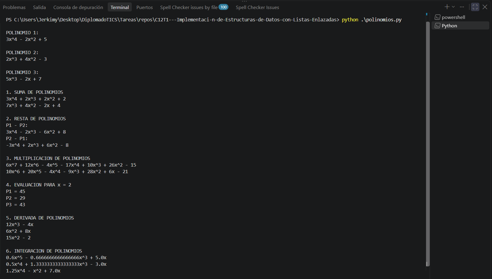
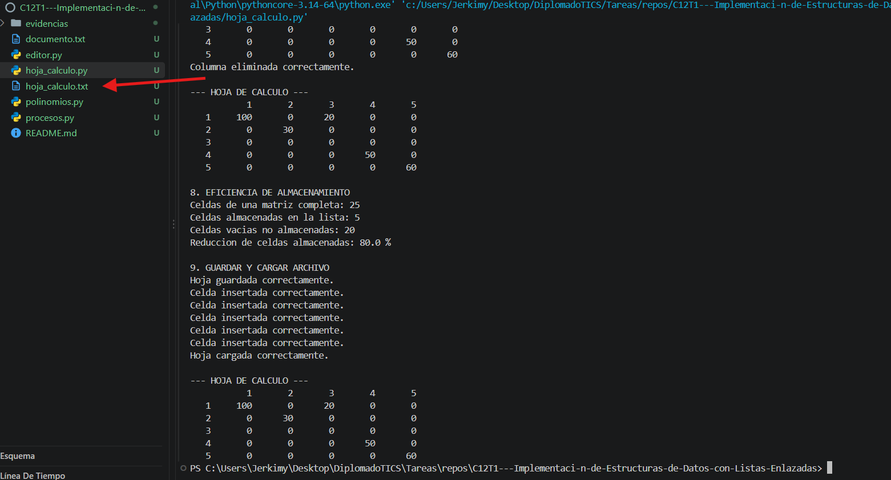

# Tarea: Listas Enlazadas, Pilas y Colas

Este repositorio contiene la implementación de cuatro problemas prácticos de programación utilizando **listas enlazadas simples** en Python. Cada solución aplica estructuras de datos dinámicas para gestionar información, realizar operaciones y optimizar el uso de memoria.

## Objetivo

Aplicar los conocimientos sobre listas enlazadas mediante el desarrollo de cuatro programas que resuelven problemas relacionados con la gestión de procesos, edición de texto, operaciones matemáticas y almacenamiento eficiente de información.

---

## Requisitos e instalación

**Requisitos:**
- Python 3.8 o superior.
- Visual Studio Code o cualquier editor de código.
- Terminal o consola de comandos.

**No se necesitan librerías externas**, ya que los programas utilizan funcionalidades propias de Python.

### Clonar el repositorio

Abre una terminal y ejecuta:

```bash
git clone https://github.com/Jerkimy4580/C12T1---Implementaci-n-de-Estructuras-de-Datos-con-Listas-Enlazadas.git
```

Ingresa a la carpeta del proyecto:

```bash
cd C12T1---Implementaci-n-de-Estructuras-de-Datos-con-Listas-Enlazadas
```

---

## Soluciones implementadas

### Problema 1: Gestión de procesos del sistema operativo

**Archivo:** `procesos.py`

**Descripción:**

Implementa un sistema de gestión de procesos utilizando una lista enlazada simple. Cada nodo almacena información de un proceso, incluyendo su identificador, nombre, estado, tiempo de creación y tiempo de CPU.

**Operaciones implementadas:**
- Registrar nuevos procesos al final de la lista.
- Cambiar el estado de un proceso.
- Eliminar procesos terminados.
- Mover procesos al inicio para establecer prioridad.
- Mostrar el orden de los procesos.
- Calcular el tiempo promedio de espera.

**Solución:**

Se utiliza una lista enlazada simple donde cada proceso se representa mediante un nodo conectado al siguiente. Esto permite agregar, modificar, recorrer y eliminar procesos dinámicamente sin utilizar una matriz de tamaño fijo.

**Ejecución:**

```bash
python procesos.py
```

### Problema 2: Editor de texto básico con operaciones de línea

**Archivo:** `editor.py`

**Descripción:**

Desarrolla un editor de texto básico mediante una lista enlazada simple. Cada nodo representa una línea de texto que puede modificarse independientemente.

**Operaciones implementadas:**
- Insertar líneas en cualquier posición.
- Eliminar una línea específica.
- Mover líneas a otra posición.
- Buscar palabras o textos en todas las líneas.
- Reemplazar texto en una línea determinada.
- Guardar el documento en un archivo.
- Cargar contenido desde un archivo.

**Solución:**

Cada línea se almacena en un nodo que contiene el texto y un puntero hacia el siguiente nodo. La estructura permite modificar el documento dinámicamente y almacenar su contenido en archivos de texto.

**Ejecución:**

```bash
python editor.py
```

**Archivo generado:** `documento.txt`

Este archivo se crea automáticamente al ejecutar la operación de guardado.

### Problema 3: Sistema de gestión de polinomios

**Archivo:** `polinomios.py`

**Descripción:**

Implementa un sistema matemático para representar y manipular polinomios utilizando listas enlazadas ordenadas por exponente.

**Operaciones implementadas:**
- Sumar dos polinomios.
- Restar dos polinomios.
- Multiplicar dos polinomios.
- Evaluar un polinomio para un valor de X.
- Calcular la derivada.
- Calcular la integral.
- Mostrar polinomios en formato matemático estándar.

**Solución:**

Cada nodo almacena el coeficiente y el exponente de un término del polinomio. Los términos se mantienen ordenados de mayor a menor exponente. Cuando existen exponentes iguales, sus coeficientes se combinan y los términos cuyo resultado es cero se eliminan.

Se utilizan tres polinomios diferentes para demostrar las operaciones matemáticas.

**Ejecución:**

```bash
python polinomios.py
```

### Problema 4: Implementación de una hoja de cálculo dispersa

**Archivo:** `hoja_calculo.py`

**Descripción:**

Implementa una hoja de cálculo dispersa para almacenar únicamente las celdas que contienen información, evitando reservar memoria para las celdas vacías.

**Operaciones implementadas:**
- Insertar y actualizar valores de celdas.
- Eliminar valores de celdas.
- Consultar el contenido de una celda.
- Calcular la suma y el promedio de un rango.
- Insertar y eliminar filas.
- Insertar y eliminar columnas.
- Mostrar la hoja de cálculo en formato tabular.
- Guardar y cargar información desde un archivo.

**Solución:**

Se utiliza una estructura de listas enlazadas para organizar las celdas mediante sus coordenadas de fila y columna. Cada nodo almacena las coordenadas, el valor y los punteros necesarios para recorrer la estructura.

Al guardar únicamente las celdas que contienen información, se reduce el consumo de memoria frente a una matriz tradicional que reserva espacio para todas las posiciones.

**Ejecución:**

```bash
python hoja_calculo.py
```

**Nota:** El archivo generado para guardar la hoja de cálculo dependerá del nombre definido en el código.

---

## Estructura del repositorio

La organización recomendada de los archivos es la siguiente:

```text
Tarea-Listas-Enlazadas-Pilas-y-Colas/
│
├── problema1_procesos.py
├── problema2_editor.py
├── problema3_polinomios.py
├── problema4_hoja_calculo.py
│
├── documento.txt
├── hoja_calculo.txt
│
└── README.md
```

Los archivos `.txt` se generan durante la ejecución de los programas que utilizan operaciones de almacenamiento. Por ello, pueden aparecer después de ejecutar los respectivos ejercicios.

---

## Evidencias de ejecución

En esta sección se presentan las capturas de pantalla que demuestran el funcionamiento de cada solución y sus operaciones principales.

### Problema 1: Gestión de procesos

**Evidencia de ejecución:**






### Problema 2: Editor de texto

**Evidencia de ejecución:**




### Problema 3: Gestión de polinomios

**Evidencia de ejecución:**




### Problema 4: Hoja de cálculo dispersa

**Evidencia de ejecución:**




---

## Conclusión

El desarrollo de estos cuatro problemas permitió aplicar las listas enlazadas simples en diferentes escenarios de programación. Se implementaron estructuras dinámicas para gestionar procesos, manipular documentos de texto, realizar operaciones matemáticas con polinomios y almacenar información de manera eficiente mediante una hoja de cálculo dispersa.

Estas soluciones permiten comprender la importancia de las estructuras de datos en el desarrollo de software, especialmente cuando se requiere administrar información dinámica, optimizar recursos y organizar operaciones de manera eficiente.

---
